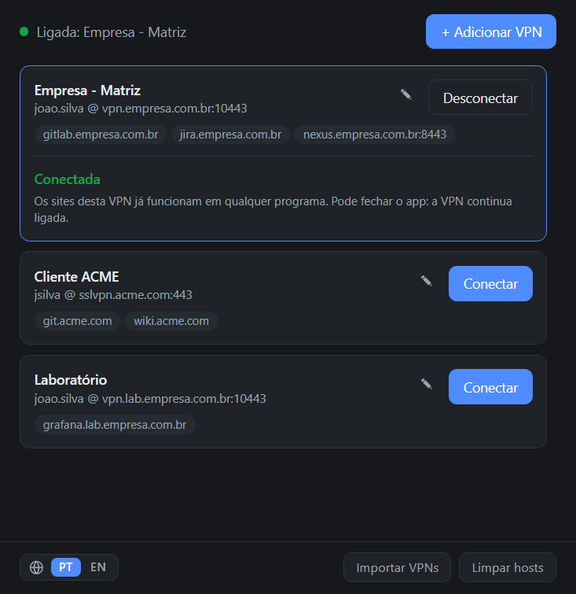
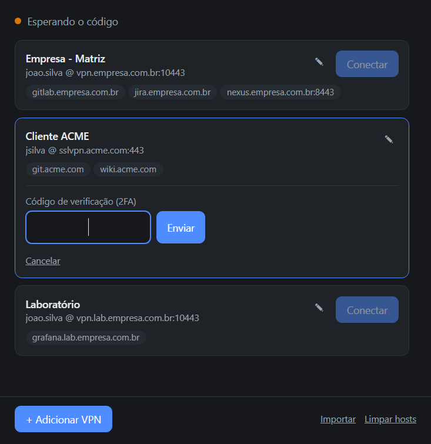
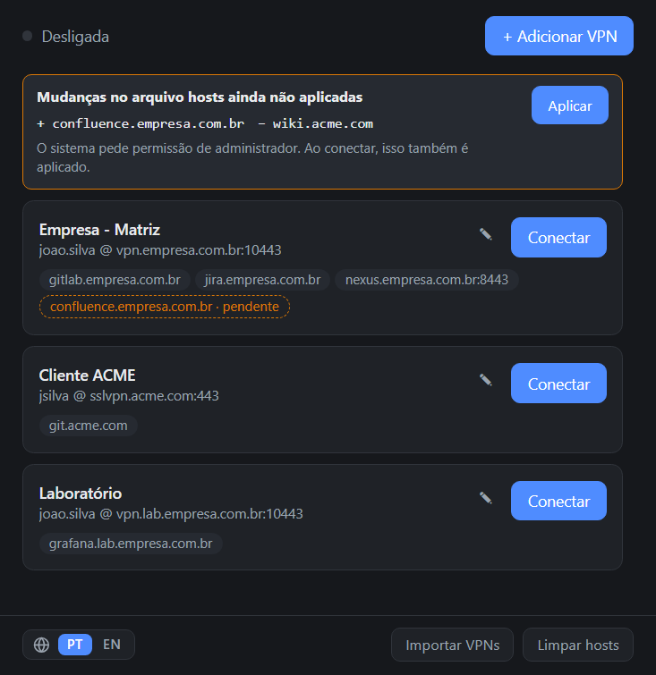

<div align="center">


# OnlyRoute

**FortiGate VPN for only the sites you choose**

*Only what needs the VPN goes through it. Everything else stays on your own connection.*

[](https://github.com/flucassena/only-route/releases/latest)

[](https://github.com/flucassena/only-route/actions/workflows/release.yml)
[](LICENSE)


**English** · [Português](README.pt-BR.md)

</div>

OnlyRoute connects to a **FortiGate SSL VPN** without FortiClient and sends **only the sites on your list** through it, such as your company's GitLab or Jira. Everything else (browsing, video calls, downloads) stays on your normal connection and never goes through the company network.

It works with any program (git, browsers, IDEs, API clients) with no proxy settings. The VPN runs inside a Docker container, so nothing is installed on or changed in your computer's network adapters.



> The app's interface is in Portuguese.

## Features

**Only the sites you choose**
- Each VPN has its own list of sites. Only those go through the tunnel; the rest of the computer can't see the company network.
- Takes a host name or a full URL (`https://gitlab.company.com/group/project`), and ports other than 443 (`nexus.company.com:8443`).
- HTTPS stays end to end: programs see the site's own certificate.

**The same login as FortiClient**
- User, password and verification code (2FA), just like FortiClient.
- User and password live in the system password vault (Windows Credential Manager, macOS Keychain or libsecret on Linux), never in a text file.
- Gateways with a self-signed certificate work by pinning the certificate's SHA-256 fingerprint.

**Many VPNs, one window**
- Add as many VPNs as you need (company, clients, lab) and switch between them with one click.
- Double-click a card to edit it.
- The app stays in the tray: the icon turns green while the VPN is on and tells you if it drops.

**Terminal only, if you prefer**
- `onlyroute.ps1` (Windows) and `onlyroute.sh` (macOS and Linux) do everything the app does, with the same commands.
- The app and the terminal share the same connection: start it in one and stop it in the other.



## Installation

**Requirements**
- Windows 10 or 11, macOS 12 or newer, or Linux x64.
- **Docker** installed and running:
  - Windows and macOS: [Docker Desktop](https://www.docker.com/products/docker-desktop/).
  - Linux: Docker Engine, with your user in the `docker` group and the PPP module loaded:

    ```sh
    sudo usermod -aG docker $USER
    sudo modprobe ppp_generic
    ```
- FortiClient closed while you use OnlyRoute.

Installers are on the [latest release](https://github.com/flucassena/only-route/releases/latest):

| System | File |
|---|---|
| Windows | `OnlyRoute-<version>-win-x64.exe` |
| macOS (Apple Silicon) | `OnlyRoute-<version>-mac-arm64.dmg` |
| macOS (Intel) | `OnlyRoute-<version>-mac-x64.dmg` |
| Linux (Debian, Ubuntu and derivatives) | `OnlyRoute-<version>-linux-amd64.deb` |
| Linux (any distribution) | `OnlyRoute-<version>-linux-x86_64.AppImage` |
| Terminal only | `OnlyRoute-<version>-cli.zip` |

**Windows**
1. Download and run `OnlyRoute-<version>-win-x64.exe`. It installs for your user only.
2. The installer isn't signed, so SmartScreen may show **"Windows protected your PC"**. Click **More info**, then **Run anyway**.

**macOS**
1. Download the `.dmg` for your Mac, open it and drag OnlyRoute to **Applications**.
2. The app isn't notarized by Apple, so macOS blocks the first launch. Run this once in Terminal:

   ```sh
   xattr -dr com.apple.quarantine /Applications/OnlyRoute.app
   ```

**Linux**
- `.deb`:

  ```sh
  sudo apt install ./OnlyRoute-<version>-linux-amd64.deb
  ```
- AppImage:

  ```sh
  chmod +x OnlyRoute-<version>-linux-x86_64.AppImage
  ./OnlyRoute-<version>-linux-x86_64.AppImage
  ```

On Linux the password vault uses `secret-tool` (package `libsecret-tools` on Debian and Ubuntu) with gnome-keyring or KWallet running.

To check a download, compare it with the `SHA256SUMS.txt` of the same release:

```sh
sha256sum -c SHA256SUMS.txt --ignore-missing          # Linux
shasum -a 256 -c SHA256SUMS.txt --ignore-missing      # macOS
```

```powershell
Get-FileHash .\OnlyRoute-<version>-win-x64.exe -Algorithm SHA256   # Windows
```

## Getting started

1. **Start Docker** and wait until it's ready.
2. **Add a VPN.** Click **+ Adicionar VPN** and fill in the gateway and port (the same as in FortiClient), your user and, if you want, your password.
3. **Pick the sites.** Under **Sites que passam pela VPN**, add each site that only opens through the VPN.
4. **Connect.** Click **Conectar** and type the verification code when asked. The first time, OnlyRoute builds the Docker image, which takes about a minute.
5. **Work as usual.** The sites on the list now open in any program. You can close the window: the VPN stays on and the app stays in the tray.

New or removed sites stay **pendente** (pending) until you click **Aplicar** (apply) or connect. The system asks for administrator permission to change the `hosts` file.



## How it works

```
Program (git, browser, ...)
   │  gitlab.company.com → 127.0.0.1                 (hosts file)
   ▼
127.0.0.1:443 ──► onlyroute container ──► openfortivpn ──► FortiGate ──► site
```

1. Each site on the list gets a line in the system `hosts` file pointing to a local address (`127.0.0.1`, `127.0.0.2`, ...). The lines are tagged `# onlyroute`, and OnlyRoute never touches any other line.
2. The program connects to that local address, and Docker hands the connection to the container.
3. Inside the container, `socat` relays the bytes, without decrypting anything, to the real site through the [openfortivpn](https://github.com/adrienverge/openfortivpn) tunnel.
4. `openfortivpn` does the same login as FortiClient: user, password and verification code.

The image is a minimal Debian (`debian:trixie-slim`) with `openfortivpn` and `socat` from the official Debian repositories. See the [Dockerfile](Dockerfile) and [entrypoint.sh](entrypoint.sh).

## Terminal only

To use it without the app, download `OnlyRoute-<version>-cli.zip` (or clone the repository): `onlyroute.ps1` on Windows, `onlyroute.sh` on macOS and Linux.

1. Copy `vpns.example.json` to `vpns.json` and add your VPNs:

   | Field | What it is |
   |---|---|
   | `id` | Short name, used in `up <id>` |
   | `name` | Name shown in the menu |
   | `gateway` / `port` | FortiClient's "Remote Gateway" and "Customize port" |
   | `forward` | Sites that go through the VPN: `"host"` (port 443) or `"host:port"` |
   | `trustedCert` | Optional. SHA-256 fingerprint of the gateway certificate |
   | `credentials` | Optional. Variable prefix in `onlyroute.env`, if you use the `.env` instead of the vault |

2. Save your user and password in the system password vault (the password is optional; without it, `up` asks):

   ```powershell
   .\onlyroute.ps1 login      # Windows
   ./onlyroute.sh login       # macOS and Linux
   ```

3. Turn it on and off:

   ```powershell
   .\onlyroute.ps1 up         # asks which VPN and for the code
   .\onlyroute.ps1 status     # is it on? which one?
   .\onlyroute.ps1 down       # turns it off
   ```

If PowerShell blocks scripts, use `powershell -ExecutionPolicy Bypass -File .\onlyroute.ps1 up` (applies to that command only). On macOS and Linux, commands that change `/etc/hosts` ask for your `sudo` password.

<details>
<summary><b>All commands</b></summary>

| Command | What it does |
|---|---|
| `up [vpn]` | Starts the VPN in the background (shows a menu if no VPN is given) |
| `down` | Stops it |
| `status` | Shows whether it's on, which VPN and the tunnel IP |
| `list` | Lists the VPNs, each one's user and its sites |
| `login [vpn]` | Saves user and password in the system password vault |
| `logout [vpn]` | Deletes user and password from the vault |
| `add <site> [vpn]` | Sends a site through the VPN (takes a full URL) and updates `hosts` |
| `remove <site> [vpn]` | Takes a site off the VPN (off all of them if no VPN is given) |
| `hosts-setup` | (Admin) Points the sites in `vpns.json` to the VPN |
| `hosts-remove` | (Admin) Removes every OnlyRoute line from `hosts` |
| `build` | Rebuilds the Docker image |
| `uninstall` | (Admin) Undoes everything: stops the VPN, cleans `hosts`, deletes the image and the vault logins |

</details>

## Security

- The connection to the company uses the same protocol as FortiClient (TLS), with the same login and the same 2FA.
- The password goes from the vault straight to openfortivpn through a channel inside the container. It's never written to a file and never appears on a command line.
- The relays listen only on local addresses (`127.0.0.x`). Other machines on the network can't use them.
- The container gets the `NET_ADMIN` and `SYS_ADMIN` capabilities and the `/dev/ppp` device, which `pppd` needs to build the tunnel. They apply inside the container only, not to your system.
- `trustedCert` pins one exact certificate: openfortivpn accepts only that certificate.
- OnlyRoute doesn't run FortiClient's compliance checks (antivirus, updates). Check with your IT team that this use is allowed at your company.

## FAQ

**Do I need FortiClient installed?**
No. Close FortiClient while you use OnlyRoute, because both fight over the same ports and routes.

**Does the rest of my traffic go through the company?**
No. Only the sites on the list use the tunnel; everything else goes out through your normal connection.

**I turned the VPN off and GitLab stopped opening. Is that normal?**
Yes. The `hosts` lines stay, so the listed sites only open while the VPN is on. To go fully back to normal (for example, to use FortiClient), use **Limpar hosts** in the app or `hosts-remove` in the terminal.

**Can I connect two VPNs at once?**
No, one at a time. To switch, disconnect one and connect the other.

**I get a gateway certificate error.**
The openfortivpn message shows the certificate fingerprint. Check with IT that it's the right certificate and put it in **Avançado › Certificado confiável do gateway** (or `trustedCert` in `vpns.json`).

**"Port already in use".**
Another program (often FortiClient) is using the site's local port. Close it and connect again.

**"Não conectou" (didn't connect).**
The last VPN messages show in the card. It's almost always a wrong password or an expired code.

## Building from source

You need Node.js 20 or newer. Each system builds its own installer.

```sh
cd app
npm install
npm start          # runs the app without installing
npm run dist       # builds the installer in app/dist/
```

Releases are built by GitHub Actions ([release.yml](.github/workflows/release.yml)). Pushing a tag builds the installers for all three systems, the terminal-only zip and `SHA256SUMS.txt`, and publishes them in a Release. The app version comes from the tag.

```sh
git tag v1.0.0
git push origin v1.0.0
```

```
app/                 Electron app (main process, password vault, interface)
onlyroute.ps1        Terminal version for Windows
onlyroute.sh         Terminal version for macOS and Linux
Dockerfile           Debian image with openfortivpn and socat
entrypoint.sh        Starts the relays and the VPN inside the container
vpns.example.json    Template for vpns.json (your vpns.json is not committed)
```

## Contributing

Bug reports, ideas and pull requests are welcome in [issues](https://github.com/flucassena/only-route/issues). When reporting a connection problem, include the last VPN messages, without your user or password.

## License and trademarks

- [CC0 1.0](LICENSE): public domain. Use, copy, change and share it freely, with no need to ask or give credit.
- [openfortivpn](https://github.com/adrienverge/openfortivpn) and the other packages in the Docker image keep their own licenses.
- FortiGate and FortiClient are trademarks of Fortinet. OnlyRoute is not affiliated with Fortinet.
