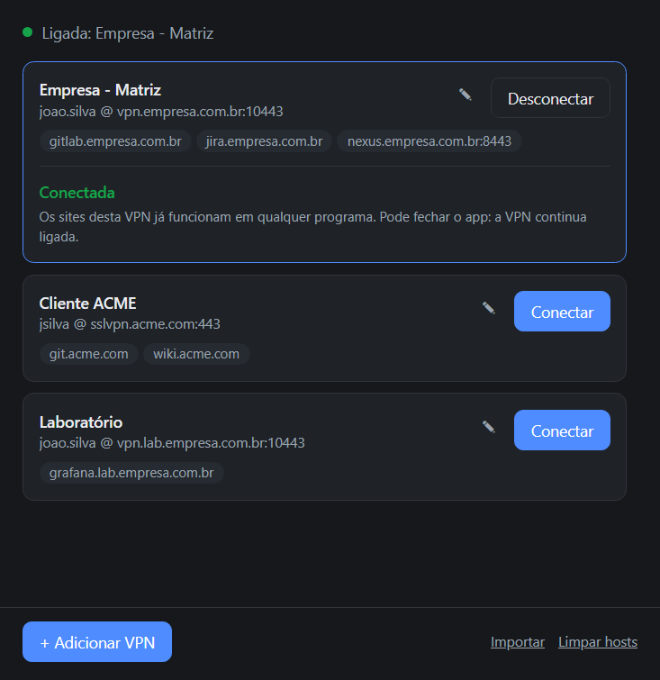
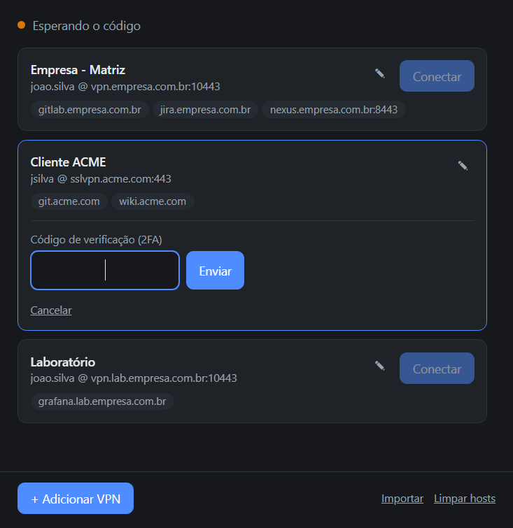
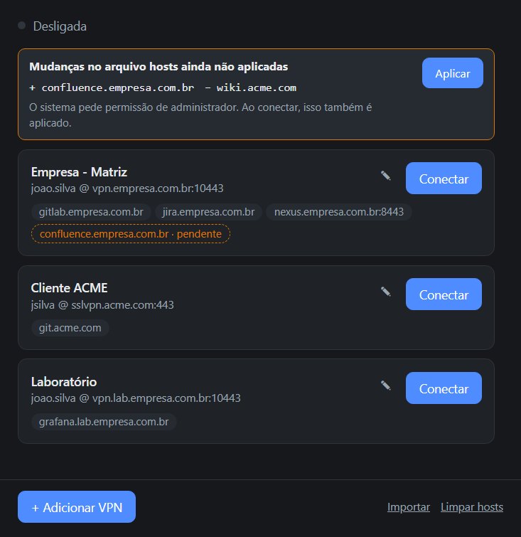

<div align="center">


# OnlyRoute

**VPN FortiGate só para os sites que você escolher**

*Só o que precisa passa pela VPN. O resto continua na sua internet.*

[](https://github.com/flucassena/only-route/releases/latest)

[](https://github.com/flucassena/only-route/actions/workflows/release.yml)
[](LICENSE)


[English](README.md) · **Português**

</div>

O OnlyRoute conecta numa VPN **FortiGate SSL VPN** sem o FortiClient e passa por ela **só os sites da sua lista**, como o GitLab ou o Jira da empresa. Todo o resto (navegação, chamadas de vídeo, downloads) continua na sua internet normal, sem passar pela empresa.

Funciona com qualquer programa (git, navegador, IDE, cliente de API) sem configurar proxy em nada. A VPN roda dentro de um container Docker, então nada é instalado nem alterado na placa de rede do seu computador.



## Recursos

**Só os sites que você escolher**
- Cada VPN tem a sua lista de sites. Só eles passam pelo túnel; o resto do PC não enxerga a rede da empresa.
- Aceita o nome do site ou a URL inteira (`https://gitlab.empresa.com.br/grupo/projeto`); portas diferentes de 443 também (`nexus.empresa.com.br:8443`).
- O HTTPS continua de ponta a ponta: o certificado que o programa vê é o do próprio site.

**O mesmo login do FortiClient**
- Usuário, senha e código de verificação (2FA), como no FortiClient.
- Usuário e senha ficam no cofre de senhas do sistema (Gerenciador de Credenciais do Windows, Chaveiro do macOS ou libsecret no Linux), nunca num arquivo de texto.
- Gateways com certificado próprio funcionam fixando a impressão digital SHA-256 do certificado.

**Várias VPNs, uma janela**
- Cadastre quantas VPNs quiser (empresa, clientes, laboratório) e troque entre elas com um clique.
- Dois cliques num cartão abrem a edição.
- O app fica na bandeja: o ícone fica verde com a VPN ligada e avisa se ela cair.

**Só terminal, se preferir**
- `onlyroute.ps1` (Windows) e `onlyroute.sh` (macOS e Linux) fazem tudo o que o app faz, com os mesmos comandos.
- O app e o terminal usam a mesma conexão: dá para ligar num e desligar no outro.



## Instalação

**Requisitos**
- Windows 10 ou 11, macOS 12 ou mais novo, ou Linux x64.
- **Docker** instalado e rodando:
  - Windows e macOS: [Docker Desktop](https://www.docker.com/products/docker-desktop/).
  - Linux: Docker Engine, com o seu usuário no grupo `docker` e o módulo PPP carregado:

    ```sh
    sudo usermod -aG docker $USER
    sudo modprobe ppp_generic
    ```
- O FortiClient fechado enquanto usar o OnlyRoute.

Os instaladores ficam na [última versão](https://github.com/flucassena/only-route/releases/latest):

| Sistema | Arquivo |
|---|---|
| Windows | `OnlyRoute-<versão>-win-x64.exe` |
| macOS (Apple Silicon) | `OnlyRoute-<versão>-mac-arm64.dmg` |
| macOS (Intel) | `OnlyRoute-<versão>-mac-x64.dmg` |
| Linux (Debian, Ubuntu e derivados) | `OnlyRoute-<versão>-linux-amd64.deb` |
| Linux (qualquer distribuição) | `OnlyRoute-<versão>-linux-x86_64.AppImage` |
| Só terminal | `OnlyRoute-<versão>-cli.zip` |

**Windows**
1. Baixe e rode o `OnlyRoute-<versão>-win-x64.exe`. Ele instala só para o seu usuário.
2. O instalador não é assinado, então o SmartScreen pode mostrar **"O Windows protegeu o computador"**. Clique em **Mais informações** e depois em **Executar assim mesmo**.

**macOS**
1. Baixe o `.dmg` do seu Mac, abra e arraste o OnlyRoute para **Aplicativos**.
2. O app não é notarizado pela Apple, então o macOS bloqueia a primeira abertura. Rode isto uma vez no Terminal:

   ```sh
   xattr -dr com.apple.quarantine /Applications/OnlyRoute.app
   ```

**Linux**
- `.deb`:

  ```sh
  sudo apt install ./OnlyRoute-<versão>-linux-amd64.deb
  ```
- AppImage:

  ```sh
  chmod +x OnlyRoute-<versão>-linux-x86_64.AppImage
  ./OnlyRoute-<versão>-linux-x86_64.AppImage
  ```

O cofre de senhas no Linux usa o `secret-tool` (pacote `libsecret-tools` no Debian e Ubuntu) com o gnome-keyring ou o KWallet rodando.

Para conferir o download, compare com o `SHA256SUMS.txt` da mesma versão:

```sh
sha256sum -c SHA256SUMS.txt --ignore-missing          # Linux
shasum -a 256 -c SHA256SUMS.txt --ignore-missing      # macOS
```

```powershell
Get-FileHash .\OnlyRoute-<versão>-win-x64.exe -Algorithm SHA256   # Windows
```

## Primeiros passos

1. **Abra o Docker** e espere ele terminar de iniciar.
2. **Adicione uma VPN.** Clique em **+ Adicionar VPN** e preencha o gateway e a porta (os mesmos do FortiClient), o seu usuário e, se quiser, a senha.
3. **Escolha os sites.** Em **Sites que passam pela VPN**, adicione cada site que só abre pela VPN.
4. **Conecte.** Clique em **Conectar** e digite o código de verificação quando ele for pedido. Na primeira vez, o OnlyRoute monta a imagem Docker, o que leva cerca de um minuto.
5. **Use normalmente.** Os sites da lista já abrem em qualquer programa. Pode fechar a janela: a VPN continua ligada e o app fica na bandeja.

Sites novos ou removidos ficam como **pendente** até você clicar em **Aplicar** (ou conectar). O sistema pede permissão de administrador para mudar o arquivo `hosts`.



## Como funciona

```
Programa (git, navegador, ...)
   │  gitlab.empresa.com.br → 127.0.0.1             (arquivo hosts)
   ▼
127.0.0.1:443 ──► container onlyroute ──► openfortivpn ──► FortiGate ──► site
```

1. Cada site da lista ganha uma linha no arquivo `hosts` do sistema, apontando para um endereço local (`127.0.0.1`, `127.0.0.2`, ...). As linhas são marcadas com `# onlyroute`, e o OnlyRoute nunca mexe nas outras.
2. O programa conecta nesse endereço local, e o Docker entrega a conexão ao container.
3. Dentro do container, o `socat` repassa os bytes, sem abrir nada, para o site de verdade pelo túnel do [openfortivpn](https://github.com/adrienverge/openfortivpn).
4. O `openfortivpn` faz o mesmo login do FortiClient: usuário, senha e código de verificação.

A imagem é um Debian mínimo (`debian:trixie-slim`) com `openfortivpn` e `socat` dos repositórios oficiais do Debian. Veja o [Dockerfile](Dockerfile) e o [entrypoint.sh](entrypoint.sh).

## Só terminal

Para usar sem o app, baixe o `OnlyRoute-<versão>-cli.zip` (ou clone o repositório): `onlyroute.ps1` no Windows, `onlyroute.sh` no macOS e no Linux.

1. Copie `vpns.example.json` para `vpns.json` e coloque as suas VPNs:

   | Campo | O que é |
   |---|---|
   | `id` | Nome curto, usado em `up <id>` |
   | `name` | Nome que aparece no menu |
   | `gateway` / `port` | "Gateway Remoto" e "Porta customizada" do FortiClient |
   | `forward` | Sites que passam pela VPN: `"host"` (porta 443) ou `"host:porta"` |
   | `trustedCert` | Opcional. Impressão digital SHA-256 do certificado do gateway |
   | `credentials` | Opcional. Prefixo das variáveis no `onlyroute.env`, se usar o `.env` em vez do cofre |

2. Grave usuário e senha no cofre de senhas do sistema (a senha é opcional; sem ela, o `up` pergunta):

   ```powershell
   .\onlyroute.ps1 login      # Windows
   ./onlyroute.sh login       # macOS e Linux
   ```

3. Ligue e desligue:

   ```powershell
   .\onlyroute.ps1 up         # pergunta qual VPN e pede o código
   .\onlyroute.ps1 status     # está ligada? qual?
   .\onlyroute.ps1 down       # desliga
   ```

Se o PowerShell bloquear scripts, use `powershell -ExecutionPolicy Bypass -File .\onlyroute.ps1 up` (vale só para aquele comando). No macOS e no Linux, os comandos que mexem no `/etc/hosts` pedem a senha do `sudo`.

<details>
<summary><b>Todos os comandos</b></summary>

| Comando | O que faz |
|---|---|
| `up [vpn]` | Liga a VPN em segundo plano (mostra um menu se não informar qual) |
| `down` | Desliga |
| `status` | Mostra se está ligada, qual VPN e o IP do túnel |
| `list` | Lista as VPNs, o usuário de cada uma e os sites |
| `login [vpn]` | Grava usuário e senha no cofre de senhas do sistema |
| `logout [vpn]` | Apaga usuário e senha do cofre |
| `add <site> [vpn]` | Passa um site pela VPN (aceita a URL inteira) e atualiza o `hosts` |
| `remove <site> [vpn]` | Tira um site da VPN (de todas, se não informar qual) |
| `hosts-setup` | (Admin) Aponta os sites do `vpns.json` para a VPN |
| `hosts-remove` | (Admin) Tira todas as linhas do OnlyRoute do `hosts` |
| `build` | Remonta a imagem Docker |
| `uninstall` | (Admin) Desfaz tudo: desliga a VPN, limpa o `hosts`, apaga a imagem e os logins do cofre |

</details>

## Segurança

- A conexão com a empresa usa o mesmo protocolo do FortiClient (TLS), com o mesmo login e o mesmo 2FA.
- A senha vai do cofre direto para o openfortivpn por um canal interno do container. Ela não é gravada em arquivo nem aparece na linha de comando.
- Os repasses escutam só em endereços locais (`127.0.0.x`). Outras máquinas da rede não conseguem usá-los.
- O `trustedCert` fixa um certificado exato: o openfortivpn só aceita aquele certificado.
- O OnlyRoute não faz as verificações de conformidade do FortiClient (antivírus, atualizações). Confirme com a TI se esse uso é permitido na sua empresa.

## Perguntas frequentes

**Preciso instalar o FortiClient?**
Não. E feche o FortiClient enquanto usar o OnlyRoute, porque os dois disputam as mesmas portas e rotas.

**O resto da minha internet passa pela empresa?**
Não. Só os sites da lista vão pelo túnel; todo o resto sai pela sua internet normal.

**Desliguei a VPN e o GitLab parou de abrir. É normal?**
Sim. As linhas do `hosts` continuam lá, então os sites da lista só abrem com a VPN ligada. Para voltar ao normal por completo (por exemplo, para usar o FortiClient), use **Limpar hosts** no app ou `hosts-remove` no terminal.

**Posso ligar duas VPNs ao mesmo tempo?**
Não, uma por vez. Para trocar, desconecte uma e conecte a outra.

**Apareceu erro de certificado do gateway.**
A mensagem do openfortivpn mostra a impressão digital do certificado. Confira com a TI se é o certificado certo e coloque em **Avançado › Certificado confiável do gateway** (ou em `trustedCert` no `vpns.json`).

**"Porta já em uso".**
Outro programa (muitas vezes o FortiClient) está usando a porta local do site. Feche-o e conecte de novo.

**"Não conectou".**
As últimas mensagens da VPN aparecem no cartão. Quase sempre é senha errada ou código expirado.

## Compilar a partir do código

Você precisa de Node.js 20 ou mais novo. Cada sistema gera o seu instalador.

```sh
cd app
npm install
npm start          # roda o app sem instalar
npm run dist       # gera o instalador em app/dist/
```

As versões são geradas pelo GitHub Actions ([release.yml](.github/workflows/release.yml)). Enviar uma tag gera os instaladores dos três sistemas, o zip da versão de terminal e o `SHA256SUMS.txt`, e publica tudo numa Release. A versão do app vem da tag.

```sh
git tag v1.0.0
git push origin v1.0.0
```

```
app/                 App Electron (processo principal, cofre de senhas, interface)
onlyroute.ps1        Versão de terminal para Windows
onlyroute.sh         Versão de terminal para macOS e Linux
Dockerfile           Imagem Debian com openfortivpn e socat
entrypoint.sh        Sobe os repasses e a VPN dentro do container
vpns.example.json    Modelo do vpns.json (o seu vpns.json não vai para o git)
```

## Contribuição

Relatos de bug, sugestões e pull requests são bem-vindos nas [issues](https://github.com/flucassena/only-route/issues). Ao relatar um problema de conexão, inclua as últimas mensagens da VPN, sem usuário nem senha.

## Licença e marcas

- [CC0 1.0](LICENSE): domínio público. Use, copie, mude e redistribua à vontade, sem pedir nem dar crédito.
- O [openfortivpn](https://github.com/adrienverge/openfortivpn) e os demais pacotes da imagem Docker mantêm as suas licenças.
- FortiGate e FortiClient são marcas da Fortinet. O OnlyRoute não tem vínculo com a Fortinet.
